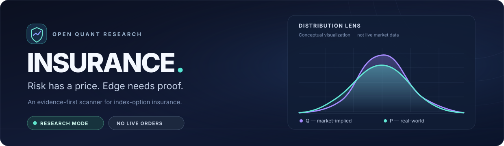
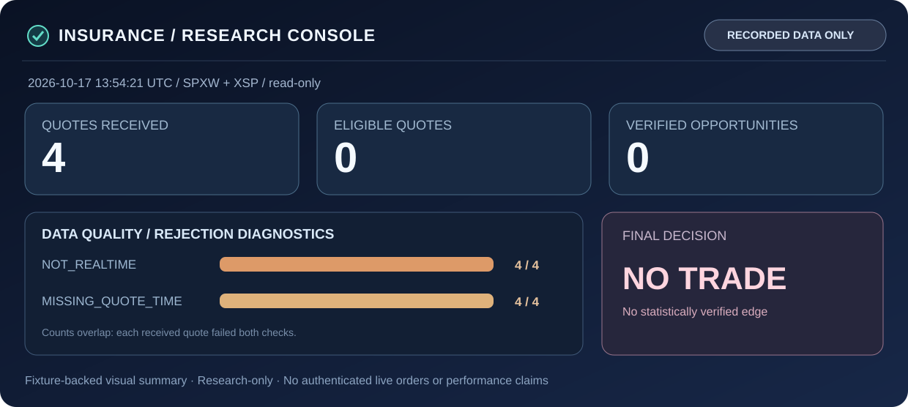

<picture>
  <source media="(max-width: 720px)" srcset="./docs/assets/insurance-hero-mobile.svg" />
  
</picture>

 

**An open-source, evidence-first laboratory for finding options insurance that might be overpriced or underpriced.**

[Why it exists](#the-idea) · [Scanner preview](#scanner-preview) · [Run the demo](#quick-start) · [Capabilities](#what-works-today) · [Architecture](#how-it-works) · [Edge validation](#the-evidence-bar) · [Market data](#bring-your-own-ibkr-market-data) · [Contribute](#contributing--security)

---

> [!IMPORTANT]
> **The current system does not recommend trades.** It can generate exploratory valuations and buy/sell research rankings, but has **no calibrated model-risk confidence intervals or point-in-time options-strategy backtest**. Every candidate is `UNVERIFIED`; the final recommendation is **`NO TRADE`**. The optional IBKR collector has not been validated as a production-quality live quote feed.

## The idea

**Don't sell options merely because implied volatility is high. Don't buy them merely because premiums look small.**

An insurance premium can only be called expensive or cheap relative to a defensible estimate of the *real-world distribution of future payouts*, net of execution costs and model uncertainty.

<table>
<tr>
<td width="50%" valign="top">

### ↗ Sell expensive insurance

**Hypothesis:** The executable credit exceeds the modeled expected payout and all costs.

- Focus on **defined-risk credit spreads**
- Measure crash exposure and the asymmetry of rare losses
- Reject apparently attractive premiums without evidence

**Desired output:** a statistically supported *SELL* candidate — not a high-win-rate guess.

</td>
<td width="50%" valign="top">

### ↘ Buy cheap insurance

**Hypothesis:** The estimated real-world payout exceeds the executable debit and all costs.

- Evaluate **long puts/calls and debit spreads**
- Quantify premium-at-risk and break-even outcomes
- Avoid mistaking a low dollar price for cheap insurance

**Desired output:** a statistically supported *BUY* candidate — not a directional hunch.

</td>
</tr>
</table>

**The most useful answer is sometimes `NO TRADE`.** This is a designed outcome, not a scanner failure.

## Scanner preview

This research-console **visualization is built from the real, checked-in October 17, 2026 negative-control snapshot**. The layout is illustrative, not a working dashboard or live stream. It shows what the scanner can reliably establish today: **four non-real-time quotes, zero eligible quotes, and no verified trade**.

Fixture-backed values · Historical data only · No fabricated opportunities or backtested performance

### What a future research candidate must show

The schema below is a **UI contract, not a trade list**. No positions are populated until validated, time-stamped data and the evidence gates are available.

| View | Modeled net EV | Conservative EV bound | Worst-case loss | Liquidity | Status |
|:--|:--|:--|:--|:--|:--|
| **BUY insurance** | Required, net of costs | Required; no approved estimate today | Defined before ranking | Executable ask, size and spread | `UNVERIFIED` |
| **SELL insurance** | Required, net of costs | Required; no approved estimate today | Spread width and all costs | Executable bid, size and spread | `UNVERIFIED` |

A future dashboard should show each candidate's actual contract legs, expiration, P/Q assumptions, model version, point-in-time bid/ask, tail loss and *why it passed or failed*. A large premium or high probability of profit is never enough.

**The decision contract:** Validate inputs → construct research candidates → estimate payoff under exploratory P → apply conservative costs and risk → **reject promotion until statistical evidence exists**. The absence of trades in this historical fixture is a correct data-quality result, not proof that the wider market has no opportunities.

## Choose your path

| I'm here to… | Start with… |
|:--|:--|
| **Run something now** | [Three-minute local quick start](#quick-start) and [reproducible output](#reproducible-demonstration) |
| **Understand opportunity pricing** | [P vs Q and evidence standards](#the-evidence-bar) |
| **Connect quote data** | [IBKR collector](#bring-your-own-ibkr-market-data) and [market-data architecture](docs/market-data-operations.md) |
| **Contribute code or delegate to agents** | [CONTRIBUTING.md](CONTRIBUTING.md), [AGENTS.md](AGENTS.md) and [factory contracts](#autonomous-software-factory) |

## What works today

The capabilities below describe code *actually present in this repository*, not the long-term mission.

| Capability | Current status | What's real |
|:--|:--|:--|
| **SPXW / XSP research** | ✅ Implemented | Read normalized index-option snapshots; distinguish PM-settled classes |
| **Calls, puts & vertical spreads** | ✅ Implemented | Long calls/puts, put/call debit spreads, defined-risk credit spreads |
| **Liquidity & data-quality gates** | ✅ Implemented | Reject delayed, frozen, stale, crossed, excessively wide and shallow quotes |
| **Real-world payout prototype (P)** | 🧪 Exploratory | EWMA volatility + filtered-historical Monte Carlo; not calibrated |
| **Buy vs. sell rankings** | 🧪 Exploratory | Net modeled P&L, probability of profit, maximum loss, 95% expected shortfall |
| **Restart-safe storage** | ✅ Implemented | SQLite snapshot deduplication and notification fingerprints |
| **CLI and unit-test CI** | ✅ Implemented | JSON output, incremental file polling, GitHub Actions test suite |
| **IBKR Gateway/TWS adapter** | ⚠️ Prototype | Read-only local collector included; not deployed or live-quote certified |
| **Risk-neutral pricing (Q)** | ⏳ Planned | Full volatility surface, term structure, arbitrage checks and parity audit |
| **Statistical edge verification** | ⏳ Planned | Historical options quotes, walk-forward trade tests, conservative EV bounds |
| **Notifications / dashboard / paper mode** | ⏳ Planned | Not operating as an autonomous signal or execution service |
| **NDX, RUT, condors, calendars** | ⏳ Planned | Not implemented in the initial scanner |

> [!NOTE]
> **Scope distinction:** The quote model recognizes regular **SPX (AM settlement)**, **SPXW (PM settlement)** and **XSP (PM settlement)**. The optional local collector currently selects **SPXW and XSP**. Support for a contract representation is *not* the same as a complete settlement-aware trading implementation.

## Quick start

**Requirements:** Python 3.11+; no broker account needed to run the included observed-data fixture.

~~~bash
git clone https://github.com/shpalac/insurance.git
cd insurance

python3 -m venv .venv
source .venv/bin/activate
python -m pip install -e .

# Run the core scanner's automated tests.
python -m unittest discover -s tests -v

# Replay the captured, ineligible October 17 snapshot.
insurance \
  --snapshot data/observations/2026-10-17-frozen.json \
  --database /tmp/insurance-research.db \
  --top 5
~~~

**Expected result:** `"recommendation": "NO TRADE"`, with `0` eligible quotes. That is a *verified data rejection*, **not evidence that the market has no mispriced options**.

### Reproducible demonstration

Want the human-readable scanner summary instead of the larger research JSON? Run:

~~~bash
python scripts/readme_demo.py
~~~

The demo calls the **actual scanner** on the tracked fixture; its output is not hand-crafted sample trades:

~~~json
{
  "as_of": "2026-10-17T13:54:21.995000+00:00",
  "data": "recorded frozen/delayed fixture; not live",
  "quotes_received": 4,
  "market_data_eligible": 0,
  "rejection_counts": {
    "NOT_REALTIME": 4,
    "MISSING_QUOTE_TIME": 4
  },
  "buy_research_candidates": 0,
  "sell_research_candidates": 0,
  "statistically_supported_candidates": 0,
  "recommendation": "NO TRADE"
}
~~~

These rejection counts **overlap**: each of the four quotes fails both checks. CI executes `python scripts/readme_demo.py --check` to guard the negative-control behavior; it also validates README-linked files via `python scripts/check_readme.py`.

To inspect the out-of-sample **volatility diagnostics** (not an options-strategy backtest):

~~~bash
insurance \
  --snapshot data/observations/2026-10-17-frozen.json \
  --volatility-diagnostic
~~~

<strong>Windows activation and command-line reference</strong>

For Windows PowerShell, activate the virtual environment with `.venv\Scripts\Activate.ps1` instead of `source .venv/bin/activate`.

| Command | Purpose |
|:--|:--|
| `insurance --help` | Show CLI flags |
| `insurance --snapshot path/to/file.json` | Run a single scan |
| `insurance --snapshot path/to/file.json --top 10` | Show up to 10 research candidates per side |
| `insurance --snapshot path/to/file.json --loop --interval 300` | Check the input every five minutes; reprocess changed file contents only |
| `insurance --snapshot path/to/file.json --volatility-diagnostic` | Report realized-volatility walk-forward diagnostics |

## How it works

~~~mermaid
flowchart TD
    A["IBKR read-only collector or normalized JSON snapshot"] --> B["Market data and contract validation"]
    B -->|stale, frozen, crossed, missing| X["NO TRADE"]
    B -->|eligible| C["P forecast prototype EWMA + filtered history"]
    C --> D["Construct defined-risk candidates"]
    D --> E["Price at bid/ask deduct modeled costs"]
    E --> F["Risk filters max loss, liquidity, tail loss"]
    F --> G["Separate BUY / SELL research rankings"]
    G --> H["UNVERIFIED No validated EV confidence bound"]
    H --> X
    B -.-> S[("SQLite observations")]
    Q["Future: arbitrage-consistent Q surface"] -.-> G
    V["Future: point-in-time options backtest and model uncertainty"] -.-> G

    classDef safety fill:#3B2330,color:#F5D5E2,stroke:#C15C79;
    classDef research fill:#142D38,color:#E0F9F3,stroke:#4CAFA5;
    classDef future fill:#202B42,color:#E1E8FB,stroke:#6E87B4,stroke-dasharray:5 3;
    class X,H safety;
    class C,D,E,F,G research;
    class Q,V future;
~~~

**Design principles:** deterministic and testable calculations · timestamped inputs · explicit risk assumptions · read-only integration · fail-closed decisions · no simulated returns presented as live performance.

### Code map

| Module | Responsibility |
|:--|:--|
| [`core.py`](src/insurance/core.py) | Quote validation, strategy payoffs, P-simulation, research ranking and fail-closed output |
| [`ibkr.py`](src/insurance/ibkr.py) | Optional local TWS/Gateway collector, explicitly read-only |
| [`backtest.py`](src/insurance/backtest.py) | Walk-forward **volatility diagnostic only** (not trade P&L) |
| [`storage.py`](src/insurance/storage.py) | Idempotent SQLite observation and notification state |
| [`cli.py`](src/insurance/cli.py) | One-shot / polling CLI and JSON results |
| [`tests/`](tests/) | Core logic and safety-regression tests |
| [`docs/architecture/`](docs/architecture/) | Architecture reference |

## The evidence bar

### Two distributions, two different questions

| | Risk-neutral **Q** | Real-world **P** |
|:--|:--|:--|
| **Question** | What probabilities are embedded in market option prices? | What outcomes might actually occur? |
| **Primary inputs** | Option surface, forwards, interest/carry, parity | Returns, volatility clustering, regimes, jumps |
| **Role** | Analyze what the market charges | Estimate expected future payout |
| **Today** | **Not implemented** | **Exploratory EWMA/filtered-historical model** |

For a cash-settled vertical spread, using a $100 contract multiplier:

~~~text
SELL expected net P&L =
    executable credit × 100
  − modeled expected settlement payout under P × 100
  − transaction and execution costs

BUY expected net P&L =
    modeled expected settlement payout under P × 100
  − executable debit × 100
  − transaction and execution costs
~~~

The scanner uses **short-leg bid / long-leg ask** for credit entries and **long-leg ask / short-leg bid** for debit entries. It applies configurable assumed commissions and slippage, but these are **not yet reconciled to actual broker fills**. A production fair-value estimate must also account for appropriate discounting, financing and settlement conventions.

**A positive modeled EV is not proof of an edge.** Ultimately a candidate must pass out-of-sample option-payout validation, sensitivity and stress testing, correction for selection effects, execution-quality checks and a conservative *positive lower confidence bound* on net EV. None of these evidence gates is implemented as an approval engine yet.

**Full evidence framework:** [eight auditable promotion gates, required candidate fields and statistical criteria](docs/research-validation.md). This is the implementation roadmap for turning exploratory rankings into scientifically supported signals — not a current capability.

### Safety contract

| Hard boundary | Present behavior |
|:--|:--|
| **Order execution** | No code path for submitting, modifying or cancelling live orders |
| **Strategy risk** | Long options and capped-loss vertical spreads only; no naked short options |
| **Per-candidate max loss** | Default research filter: **$1,000**; configurable, not a portfolio-level limit |
| **Quote age** | Maximum **30 seconds**, based on provided timestamp; timestamp provenance needs further verification |
| **Market data type** | `REALTIME` required for both option and underlying; delayed/frozen rejected |
| **Expiration** | **7–90 DTE** scanner eligibility; collector prioritizes **20–60 DTE** |
| **Scoring** | Descriptive *partial* score; statistical-confidence and robustness components are not validated |
| **Promotion to actionable** | Disabled. All results `UNVERIFIED`; final output `NO TRADE` |

> [!CAUTION]
> A high probability of profit, a large premium, or a high exploratory score **does not** make a position safe or profitable. A defined maximum loss also does not eliminate gap risk, market illiquidity, model failure, or portfolio concentration risk.

## First real-data observation

Captured October 17, 2026 · Historical fixture, not a live dashboard

| Observed | Result | Interpretation |
|:--|--:|:--|
| SPX / XSP option quote samples | **4** | Bid/ask figures obtained from authorized IBKR read-only access |
| Eligible option quotes | **0** | `FROZEN_DELAYED` and no verifiable bid/ask timestamps |
| Statistically supported trades | **0** | No evidence to support a trade classification |
| Historical index closes | **251 per index** | SPX and XSP daily closes available for volatility research |
| Final output | **`NO TRADE`** | Correct fail-closed outcome for this snapshot |

See the reproducible [observed snapshot](data/observations/2026-10-17-frozen.json) and [research CI workflow](.github/workflows/ci.yml). The stored sample contains delayed/frozen prices **for testing only**; it is not an executable quote or a claim about today's market.

## Bring your own IBKR market data

The optional collector requires a locally running **IBKR TWS or IB Gateway**, suitable market-data entitlements and API access configured for read-only use. It cannot use the separate ChatGPT IBKR connection as a persistent GitHub-hosted session.

~~~bash
python -m pip install -e '.[broker]'

# Terminal 1: collect local, read-only snapshots.
insurance-ibkr --host 127.0.0.1 --port 7497 --loop --interval 300

# Terminal 2: scan when the snapshot content changes.
insurance --snapshot data/snapshots/ibkr.json --loop --interval 300
~~~

- The collector defaults to **port 7497** (commonly paper TWS), connects with `readonly=True` and issues **no orders**.
- Its current conservative session check covers weekday **09:30–16:00 America/New_York** only. It is *not* a complete exchange holiday, early-close or overnight-options calendar.
- IBKR's snapshot `ticker.time` is **not proven to be a bid/ask update timestamp**. Independently verified quote receipt times, subscription health, pacing and reconnection must be implemented before production use.
- Snapshots, databases and credentials should stay in untracked local storage. GitHub-hosted CI is **ephemeral** and does **not** provide a continuously running authenticated broker session.

For the **architecture of market-hours monitoring**, including private persistent collectors, durable snapshots, stateless scheduled runners, session calendars and failure modes, read [Market data & operations](docs/market-data-operations.md).

For data providers, expiration selection, input schema details and validation behavior, start in [`ibkr.py`](src/insurance/ibkr.py), [`Quote.from_dict()`](src/insurance/core.py) and the checked-in [observed fixture](data/observations/2026-10-17-frozen.json).

## Roadmap

| Stage | Objective | Exit criterion |
|:--|:--|:--|
| **01 — Trust the feed** | Timestamp-proven, entitlement-aware streaming, calendar, settlement and provenance | Reliable point-in-time executable prices, including reconnections |
| **02 — Estimate P & Q** | Forecast ensemble, no-arbitrage Q surface, skew, forwards, jump/regime models | Calibrated distributions with documented sensitivity |
| **03 — Prove the edge** | Historical option bid/ask, expiry P&L, walk-forward fills, stress and multiple-testing corrections | Positive conservative **net** EV bound out of sample |
| **04 — Control the risk** | Portfolio constraints, capital/margin estimation, correlation, circuit breakers | Hard risk gates enforced independently of score |
| **05 — Operationalize** | Scheduled external collectors, selective notifications, dashboard, paper tracking | Restart-safe monitoring with audit trails; no stale alerts |
| **06 — Broaden coverage** | NDX/RUT, condors, calendars, more expiries and benchmarks | Validation of each new strategy/instrument class |

No stage implicitly authorizes automatic trading. **LIVE remains outside this implementation and would require explicit human approval for proposed orders.**

## Autonomous software factory

A separate, repository-agnostic engineering subsystem manages **how this code is developed**, not how money is traded.

<strong>Explore the factory contracts, CI and issue-closure safeguards</strong>

The factory's long-term target is:

~~~text
Executable GitHub issue → ownership lease → isolated implementation
→ acceptance tests → selective CI → reviewed merge
→ post-merge verification → audited issue closure
~~~

**Current operational boundary:** the configuration sets `orchestration.enabled: false`. The repository has validation scripts, issue/acceptance manifests and workflows for selective checks and verified post-merge closure, but **does not run a persistent autonomous LLM dispatcher**.

A merged `Refs #N` PR is *not enough* to close an issue: the verifier must prove the registered acceptance criteria against the current `main` SHA, with required CI evidence. Missing targets or unsupported runners leave issues open.

~~~bash
python3 -m pip install -r .factory/requirements-dev.txt
python3 .factory/scripts/validate_config.py
python3 -m unittest discover -s .factory/tests -v
~~~

**Read next:** [Agent instructions](AGENTS.md) · [Factory configuration](.factory/config.yaml) · [Role assignment](docs/factory/agent-assignment.md) · [Factory rollout](docs/factory/rollout.md) · [Post-merge closure](docs/factory/post-merge-closure.md).

## Contributing & security

Contributions that improve **data correctness, reproducibility, statistical validation and safety** are the priority. Add tests for failure modes, keep research claims attributable to data and label assumptions explicitly.

**Start here:** [Contribution guide](CONTRIBUTING.md) · [Agent operating rules](AGENTS.md) · [Research evidence gates](docs/research-validation.md) · [MIT License](LICENSE).

This is a **public repository**. Never commit IBKR credentials, account data, customer records, PII or private market-data exports. Follow [`SECURITY.md`](SECURITY.md) and [`AGENTS.md`](AGENTS.md).

---

**No hype. No invented edge. No trade without evidence.**

Quantitative research software · Not financial advice · No profitability or live-performance claims

