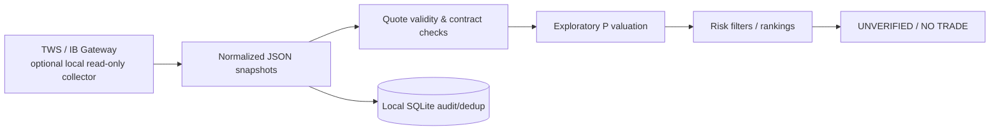
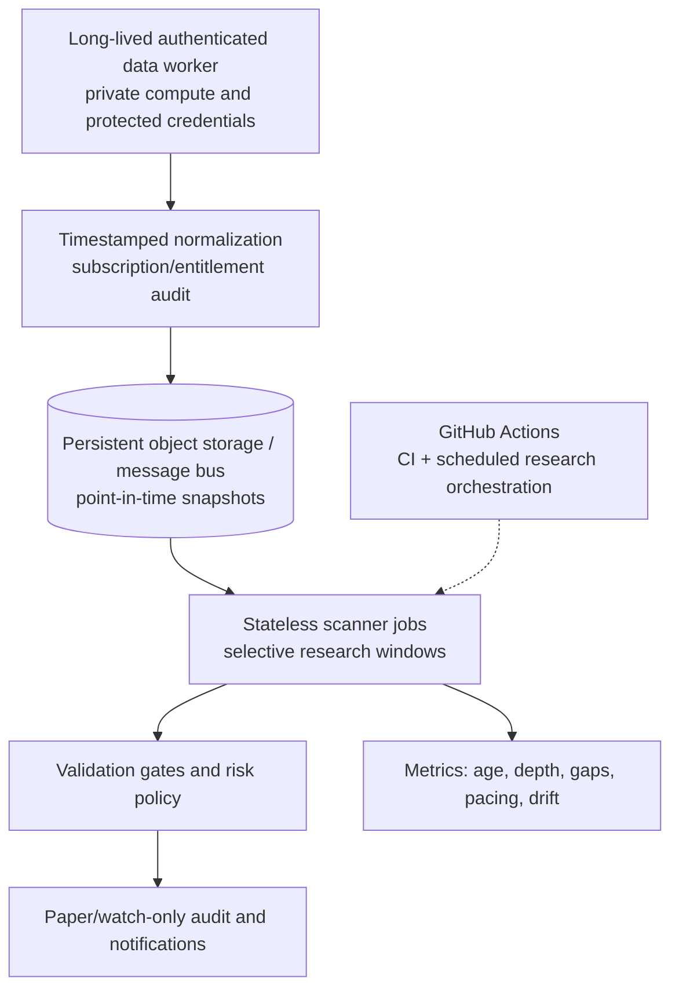

# Market data and operating model

> This document describes the **desired** operating system and the
> limitations of the **current** code. It is not deployment confirmation.

## Current flow

- The optional collector uses locally running IBKR TWS/Gateway and a
  market-data subscription. It is not an authenticated cloud data service.
- The scanner can poll a changed **file** every 300 seconds. File polling
  does not equate to continuous broker streaming.
- The October 17, 2026 snapshot is historical, delayed/frozen, and lacks
  verifiable bid/ask reception timestamps. It is a **negative-control**
  research fixture, not an executable market snapshot.
- The current code does **not** send live orders, issue validated
  opportunities or operate an always-on dashboard.

## Design for a market-hours collector

For production-grade monitoring, operate the authenticated broker connector on
a **persistent, secured worker** and export authorized snapshots to durable
storage. Stateless scheduled workers, including GitHub-hosted runners, can then
process the snapshots **without** receiving a broker password or TWS session.

GitHub Actions is useful for builds, unit tests, replay jobs and periodic
research tasks, but ephemeral runners and scheduled-trigger delays make it an
unreliable substitute for a persistent market-data session. A scheduled
workflow should be idempotent, use concurrency control, check freshness itself,
and **fail closed** if delivery or clock assumptions are violated.

## Session boundaries and reliability checklist

- Convert timestamps using `America/New_York` with daylight-saving
  transitions. Do not hard-code a UTC offset.
- Use an authoritative exchange calendar for actual holidays, half days,
  AM/PM settlement classes and any supported overnight sessions.
- Gate collection on both contract-specific exchange hours and provider
  market-data entitlements; current weekday 09:30–16:00 check is incomplete.
- Store independent quote receipt times (and ideally exchange times);
  IBKR's `ticker.time` alone is not currently verified as the bid/ask time.
- Detect disconnects, subscriptions lapsing, frozen/delayed feed changes,
  crossed prices, stale underlying spots, option-chain pacing and duplicates.
- Persist observations with stable instrument keys, provenance,
  schema/model versions and observed times; never fabricate missing prices.
- Keep private account or licensed data outside Git history, public
  Actions artifacts and unencrypted logs.

## Safe adoption sequence

1. Run the [recorded README demo](../README.md#quick-start) and scanner tests.
2. Verify live data rights, contract settlement, quote timestamps and
   reconnect behavior on a **private** collector instance.
3. Replay a historical authorized dataset with point-in-time option quotes.
4. Implement calibrated P/Q models, validation gates and portfolio controls.
5. Deploy observation-only jobs and notifications with measured staleness.
6. Consider a paper environment only after model and execution validation.

No step here authorizes live trading. For the implementation read
[`ibkr.py`](../src/insurance/ibkr.py),
[`core.py`](../src/insurance/core.py) and
[`storage.py`](../src/insurance/storage.py).
